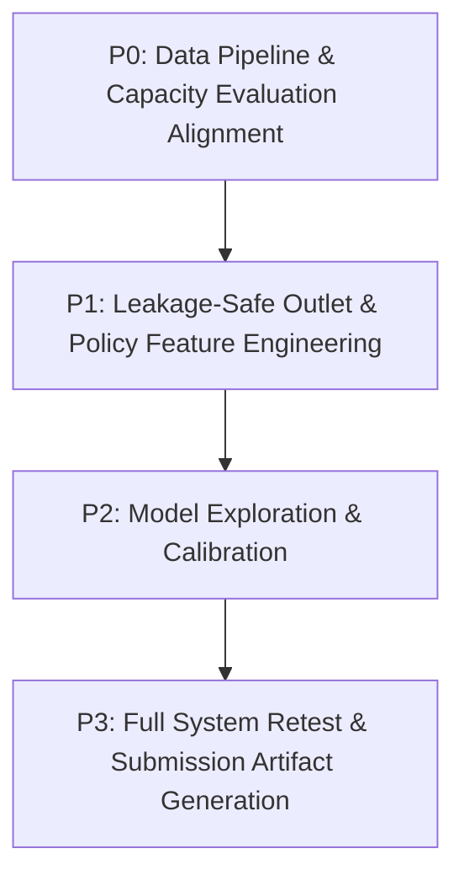

# Kestrel Warranty Fraud Detection — Technical Audit Report (Task 2 Resubmission Preparation)

**Auditor:** Senior Machine Learning Engineer, Fraud Analytics Specialist, and Code Auditor  
**Date:** October 2026  
**Project:** Kestrel Warranty Fraud Detection (Variant C)  
**Status:** Read-Only Technical Audit Completed — Zero Project Files Modified / Overwritten  

---

## 1. Executive Summary

This independent technical audit was conducted following the rejection of the initial Task 2 submission for Kestrel Home Appliances warranty fraud detection. The previous reviewer correctly noted that:
1. Fraud is heavily concentrated in a small number of outlets.
2. Fraud surged in small claims following the May 1, 2026 inspection policy change.
3. The existing model lacks outlet-specific historical information.
4. Historical outlet claim features must be constructed without leakage.
5. The May policy change must be evaluated explicitly.
6. Operational performance must be measured against the actual desk capacity of 40 reviews per month.

### Key Audit Findings

| Area | Audit Finding | Severity / Impact |
|---|---|---|
| **Outlet Fraud Concentration** | **Confirmed.** Across the 11,146 labeled claims, only 51 out of 366 partners (13.9%) ever had confirmed fraud. The top 5 partners accounted for 38.3% of all fraud; the top 10 accounted for 63.1%. In the validation window (April–June 2026), just 5 outlets accounted for 64.4% (29/45) of all fraud cases. | **Critical:** Confirming the reviewer's observation. Current model uses zero outlet-specific history. |
| **May Policy Shift** | **Confirmed.** On May 1, 2026, claims under ₹2,000 were auto-approved without inspection. Pre-May (April 2026), small claims had a 1.12% fraud rate (vs 1.52% in large claims). Post-May (May–June 2026), **35 out of 36 fraud cases (97.2%) occurred in small claims (< ₹2,000)** with a fraud rate of 3.23% (vs 0.30% in large claims). All 35 small frauds came from just 9 partners. | **Critical:** The fraud vector completely inverted on May 1, 2026. The existing model was completely blind to this shift. |
| **Actual Desk Capacity Failure** | **Deficit Revealed.** The previous submission reported `Precision@40 = 10.0%` (4/40) and net benefit `+₹4,122` by pooling the entire 3-month validation period into a single 40-claim queue. However, the operations desk reviews **40 claims each month** (120 reviews over 3 months). When evaluated month-by-month, the model achieved `Precision@40 = 7.5%` (+₹1,504) in April, but collapsed to `Precision@40 = 2.5%` (-₹22,965) in May and `2.5%` (-₹22,982) in June. Across the true 120-review budget, the model generated 115 false alarms and produced a **net loss of -₹44,443**. | **Critical:** The reported `+₹4,122` was an artifact of pooling 3 months into a 40-item budget instead of evaluating against the monthly operational capacity. |
| **Label Timing & Leakage Risks** | **High Leakage Risk.** `train.csv` contains `submitted_at`, but **no resolution/investigation timestamp**. Computing an outlet's historical fraud rate using past claims' `is_fraud` assumes instantaneous label availability, introducing future-label leakage. Furthermore, in legacy Zoho records, undecided claims were stored as 0. | **P0 Blocker:** Pure telemetry features (claim counts, rolling frequency, small-claim ratio) are safe. Label-based historical fraud rates are hazardous without explicit lag assumptions. |
| **Model & Artifact Integrity** | Current artifacts (`models/selected_model.pkl`, `models/engineer.pkl`) reproduce reported validation scores and `outputs/predictions.csv` exactly (max float difference $< 10^{-16}$). The pipeline is clean, well-tested, and reproducible, but requires architectural enhancement for Task 2 Version 2. | **Clean Baseline:** Verified reproducibility. |

---

## 2. Verified Repository Inventory

The repository root is located at `d:\AI_ML_JOURNEY\PYTHON_LEARNING\Projects\Kestrel-Fraud-Detection`.

### 2.1 File & Directory Inventory

```
Kestrel-Fraud-Detection/
├── .env                              # Untracked runtime environment variables (verified gitignored)
├── .env.example                      # Template documentation for environment variables
├── .git/                             # Git VCS repository
├── .gitignore                        # Git exclusion configuration
├── .pytest_cache/                    # Pytest execution cache
├── README.md                         # Comprehensive project documentation
├── README.txt                        # Original challenge documentation provided with dataset
├── api/                              # REST API and Web Dashboard application
│   ├── ai_assistant.py               # Groq LLM-powered investigation note generator
│   ├── alerts.py                     # Zapier Catch Hook webhook alert dispatcher & SQLite event store
│   ├── app.py                        # Flask web application exposing REST routes and dashboard
│   ├── explainer.py                  # TreeSHAP explainer for LightGBM predictions
│   └── templates/
│       └── index.html                # Vanilla JS / CSS interactive operational dashboard
├── business_memo.md                  # Executive memo for operations leadership (Phase 1)
├── email-thread.txt                  # Pre-engagement communications between Kestrel stakeholders
├── models/                           # Persisted model and pipeline artifacts
│   ├── baseline.pkl                  # Logistic Regression pipeline artifact (3.9 KB)
│   ├── engineer.pkl                  # Fitted FraudFeatureEngineer artifact (14.2 KB)
│   ├── lgbm.pkl                      # Tuned LightGBM model artifact (39.8 KB)
│   ├── selected_model.pkl            # Selected production model artifact (identical to lgbm.pkl)
│   └── training_meta.json            # Model configuration, features, and validation metrics
├── ops-policy.pdf                    # Official Kestrel Operations Policy v4.1 (authoritative rules)
├── outputs/                          # Outputs and evaluation artifacts
│   ├── alerts.db                     # SQLite database tracking webhook alert idempotency
│   ├── bulk_scored_latest.csv        # Upload cache for dashboard bulk scoring
│   ├── curves_baseline.png           # Baseline ROC & PR curves
│   ├── curves_lgbm.png               # LightGBM ROC & PR curves
│   ├── evaluation_report.md          # Phase 1 evaluation report
│   ├── feature_importance.png        # Feature gain importance chart
│   └── predictions.csv               # Final scored test set submission (2,252 rows)
├── partners.csv                      # Reference table: 380 partner records
├── products.csv                      # Reference table: 21 SKU records
├── requirements.txt                  # Python dependencies
├── sample_submission.csv             # Template submission format (2,252 rows)
├── src/                              # Core machine learning source code
│   ├── evaluate.py                   # Standalone evaluation script
│   ├── features.py                   # FraudFeatureEngineer pipeline definition
│   ├── predict.py                    # Inference script generating outputs/predictions.csv
│   └── train.py                      # Supervised training & validation pipeline
├── submission-form.md                # Task 2 submission document
├── test_unlabelled.csv               # Unlabelled test claims (2,252 rows)
├── tests/                            # Automated test suite
│   ├── test_ai_assistant.py          # 11 unit tests for Groq assistant & security
│   ├── test_alerts.py                # 7 unit tests for Zapier webhook alerting & idempotency
│   ├── test_api.py                   # Flask API test client integration suite
│   └── test_upload_workflow.py       # End-to-end HTTP integration test for dashboard upload flow
└── train.csv                         # Historical claims dataset (12,029 rows)
```

### 2.2 Component Roles & Workflow

1. **Model Pipeline (`src/`):**
   - [`src/features.py`](file:///d:/AI_ML_JOURNEY/PYTHON_LEARNING/Projects/Kestrel-Fraud-Detection/src/features.py): Implements `FraudFeatureEngineer`, joining reference data and generating 17 features.
   - [`src/train.py`](file:///d:/AI_ML_JOURNEY/PYTHON_LEARNING/Projects/Kestrel-Fraud-Detection/src/train.py): Performs data loading, deduplication, temporal split, baseline and LightGBM fitting, threshold metrics, and serializes artifacts.
   - [`src/predict.py`](file:///d:/AI_ML_JOURNEY/PYTHON_LEARNING/Projects/Kestrel-Fraud-Detection/src/predict.py): Loads artifacts, scores `test_unlabelled.csv`, and writes `outputs/predictions.csv`.
   - [`src/evaluate.py`](file:///d:/AI_ML_JOURNEY/PYTHON_LEARNING/Projects/Kestrel-Fraud-Detection/src/evaluate.py): Re-computes validation metrics on demand from persisted models.
2. **API & Dashboard (`api/`):**
   - [`api/app.py`](file:///d:/AI_ML_JOURNEY/PYTHON_LEARNING/Projects/Kestrel-Fraud-Detection/api/app.py): Exposes `GET /`, `POST /predict`, `POST /predict_bulk`, `GET /analytics`, `POST /validate_csv`, `GET /api/demo_info`, `GET /api/demo_claims`, `POST /ai/investigate`.
   - [`api/explainer.py`](file:///d:/AI_ML_JOURNEY/PYTHON_LEARNING/Projects/Kestrel-Fraud-Detection/api/explainer.py): Generates top TreeSHAP factor explanations for every prediction.
   - [`api/alerts.py`](file:///d:/AI_ML_JOURNEY/PYTHON_LEARNING/Projects/Kestrel-Fraud-Detection/api/alerts.py): Dispatches outbound webhooks for HIGH risk claims, storing state in `outputs/alerts.db`.
   - [`api/ai_assistant.py`](file:///d:/AI_ML_JOURNEY/PYTHON_LEARNING/Projects/Kestrel-Fraud-Detection/api/ai_assistant.py): Constructs structured 5-part investigation briefs via Groq LLM API.
3. **Execution Instructions:**
   - Training: `python src/train.py`
   - Evaluation: `python src/evaluate.py`
   - Inference: `python src/predict.py`
   - API / UI Server: `python api/app.py`
   - Test Execution: `python -m pytest tests/test_api.py -v`, `python tests/test_alerts.py`, `python tests/test_ai_assistant.py`.

---

## 3. Dataset and Label Audit

### 3.1 Dimensions, Datatypes, and Date Ranges

| Dataset | File | Rows | Cols | Date Range (Min to Max) | Unique Claims | Target Field |
|---|---|---|---|---|---|---|
| **Training / Labeled Pool** | `train.csv` | 12,029 | 14 | 2025-04-01 03:24 to 2026-06-30 23:55 | 11,348 | `is_fraud` (0, 1, blank) |
| **Test Unlabelled** | `test_unlabelled.csv` | 2,252 | 13 | 2026-07-01 00:41 to 2026-09-30 23:46 | 2,252 | None |
| **Partners Reference** | `partners.csv` | 380 | 4 | Onboarded: 2021-03-24 to 2026-06-25 | 380 | `partner_id` (PK) |
| **Products Reference** | `products.csv` | 21 | 4 | N/A (List prices: ₹2,199 to ₹14,999) | 21 | `sku` (PK) |
| **Sample Submission** | `sample_submission.csv` | 2,252 | 2 | N/A | 2,252 | `claim_id,score` |
| **Existing Predictions** | `outputs/predictions.csv`| 2,252 | 2 | N/A | 2,252 | `claim_id,score` |

### 3.2 Duplicate Investigation

- **`train.csv` Duplicates:**
  - 1,362 rows contain duplicated `claim_id` values (681 unique claim IDs, each appearing exactly twice).
  - Inspection of all 681 pairs confirmed that 100% of feature values (`partner_id`, `sku`, `claim_amount_inr`, `product_serial`, `photo_attached`, `partner_inspected`, `claim_description`, `source`, `is_fraud`) are identical. Only `submitted_at` differs.
  - **Business Root Cause:** Tanmay Kulkarni confirmed: *"Partners re-submit claims when they're bounced, so the same claim number can show up twice."*
  - **Split Straddling:** Exactly 5 duplicate pairs straddled the 2026-04-01 train/validation boundary. Deduplicating by keeping the first submission (`keep='first'`) prevented cross-split leakage.
- **`test_unlabelled.csv` Duplicates:** Exactly 0 duplicates (2,252 unique claim IDs).

### 3.3 Target Label Distribution & Zoho/CRM Nuance

In `train.csv`, the raw `is_fraud` distribution is:
- `0`: 11,669 (97.01%)
- `1`: 145 (1.21%)
- `NaN` (blank): 215 (1.79%)

#### Label Breakdown by Source System

| Source System | Operational Window | is_fraud = 0 | is_fraud = 1 | is_fraud = BLANK | Fraud Rate (of resolved) |
|---|---|---|---|---|---|
| **`legacy_zoho`** | 2025-04-01 to 2025-09-30 | 4,828 | 47 | **0** | 0.96% |
| **`crm`** | 2025-10-01 to 2026-06-30 | 6,841 | 98 | **215** | 1.41% |

> [!IMPORTANT]
> **Critical Data Architecture Reality:**
> 1. Tanmay Kulkarni's email: *"Cases still under investigation are blank in the CRM - but Zoho couldn't store blanks, so the old ones came across as 0."*
> 2. This means `legacy_zoho` has **label noise**: claims that were still under review when Zoho was sunset were converted to `0`.
> 3. `crm` records properly maintain unresolved claims as blanks (215 rows). These rows span from 2025-10-01 to 2026-06-30.
> 4. Deduplication keeping first submission leaves 11,146 labeled claims (141 confirmed frauds) and 202 blank claims.

### 3.4 Temporal Split Analysis

The existing pipeline divides the 11,146 labeled claims as follows:
- **Training Set (`submitted_at < 2026-04-01`):** 9,015 claims | 96 confirmed fraud cases (1.065% fraud rate).
- **Validation Set (`2026-04-01 <= submitted_at < 2026-07-01`):** 2,131 claims | 45 confirmed fraud cases (2.112% fraud rate).
- **Test Set (`submitted_at >= 2026-07-01`):** 2,252 claims (unlabelled Q3 2026).

---

## 4. Outlet-Level Fraud Concentration Analysis

The reviewer observed that **"fraud is concentrated in a small number of outlets."**

### 4.1 Overall Concentration (Entire 11,146 Labeled History)

- **Total Unique Outlets:** 366 unique `partner_id`s submitted claims.
- **Outlets with >= 1 Confirmed Fraud:** Only **51 outlets (13.93%)**.
- **Outlets with 0 Confirmed Fraud:** **315 outlets (86.07%)**.

#### Cumulative Fraud Concentration (Pareto Distribution)

| Top N Outlets | % of All Outlets | Cumulative Fraud Cases | % of All Confirmed Fraud |
|---|---|---|---|
| **Top 1 Outlet** (SP3207) | 0.3% | 13 | **9.2%** |
| **Top 3 Outlets** | 0.8% | 35 | **24.8%** |
| **Top 5 Outlets** | 1.4% | 54 | **38.3%** |
| **Top 10 Outlets** | 2.7% | 89 | **63.1%** |
| **Top 15 Outlets** | 4.1% | 102 | **72.3%** |
| **Top 20 Outlets** | 5.5% | 110 | **78.0%** |
| **Top 30 Outlets** | 8.2% | 120 | **85.1%** |

### 4.2 Concentration in Out-of-Time Validation (April–June 2026)

In the 3-month validation window, there were **45 confirmed fraud cases** across 365 active outlets.
- Only **18 outlets** had any confirmed fraud.
- **Top 5 outlets generated 29 of the 45 fraud cases (64.4%)**:
  1. `SP3160`: 10 frauds (22.2% of validation fraud)
  2. `SP3232`: 7 frauds (15.6%)
  3. `SP3318`: 5 frauds (11.1%)
  4. `SP3129`: 4 frauds (8.9%)
  5. `SP3319`: 3 frauds (6.7%)

#### Complete Breakdown of Validation Fraud Outlets

| Partner ID | Partner Type | City | Onboarded Date | Train Claims | Train Fraud | Val Claims | Val Fraud | Val Fraud Share |
|---|---|---|---|---|---|---|---|---|
| **SP3160** | ASC | Pune | 2025-12-27 | 21 | 0 | 18 | **10** | 22.2% |
| **SP3232** | ASC | Jaipur | 2025-11-26 | 24 | 0 | 16 | **7** | 15.6% |
| **SP3318** | Franchise | Hubballi | 2025-12-06 | 16 | 0 | 13 | **5** | 11.1% |
| **SP3129** | ASC | Chennai | 2026-01-19 | 11 | 0 | 14 | **4** | 8.9% |
| **SP3319** | Franchise | Warangal | 2026-02-11 | 3 | 0 | 11 | **3** | 6.7% |
| **SP3286** | ASC | Mysuru | 2026-06-04 | 0 | 0 | 2 | **2** | 4.4% |
| **SP3118** | ASC | Pune | 2026-06-03 | 0 | 0 | 2 | **2** | 4.4% |
| **SP3207** | Franchise | Hyderabad | 2022-02-23 | 30 | 11 | 9 | **2** | 4.4% |
| **SP3103** | Franchise | Jaipur | 2022-07-27 | 26 | 8 | 8 | **1** | 2.2% |
| **SP3027** | Freelance | Pune | 2025-12-03 | 2 | 0 | 3 | **1** | 2.2% |
| **SP3197** | Franchise | Nashik | 2023-03-01 | 22 | 0 | 10 | **1** | 2.2% |
| **SP3155** | ASC | Coimbatore | 2023-10-01 | 18 | 0 | 4 | **1** | 2.2% |
| **SP3121** | Franchise | Jaipur | 2021-10-08 | 30 | 0 | 6 | **1** | 2.2% |
| **SP3269** | Franchise | Delhi | 2024-02-04 | 32 | 0 | 7 | **1** | 2.2% |
| **SP3293** | Franchise | Indore | 2022-05-24 | 26 | 1 | 6 | **1** | 2.2% |
| **SP3275** | Freelance | Coimbatore | 2022-02-19 | 34 | 0 | 6 | **1** | 2.2% |
| **SP3371** | ASC | Hubballi | 2023-01-20 | 22 | 0 | 5 | **1** | 2.2% |
| **SP3373** | Franchise | Nagpur | 2022-03-10 | 28 | 0 | 6 | **1** | 2.2% |

### 4.3 Crucial Temporal Insight on Outlets

- **15 out of the 18 validation fraud outlets had 0 fraud in training.**
- **The top 5 fraud outlets in validation were all onboarded between late November 2025 and February 2026.**
- In training, they submitted legitimate-looking claims. Then, as soon as the May 1 policy change occurred, their fraud surged.
- **Why raw historical fraud rate fails:** If a model uses historical confirmed fraud rate, outlets like `SP3160`, `SP3232`, `SP3318`, and `SP3129` had a historical fraud rate of `0.00%` when entering validation! An unregularized or unlagged historical fraud rate would label them as completely safe.
- **What actually identifies them:** Their **claim frequency, burstiness, and shift towards small claims** (e.g., median days since last claim dropped to 5.0 days vs 11.6 days for legitimate partners).

---

## 5. May Inspection-Policy Change Analysis

The reviewer observed: **"Fraud occurs in small claims after the May inspection-policy change."**

### 5.1 Documented Policy Change

- **Document Source:** `ops-policy.pdf` §5 (Kestrel Operations Policy v4.1).
- **Effective Date:** **1 May 2026**.
- **Rule:** *"Until 30 Apr 2026 every claim required partner inspection sign-off. From 1 May 2026, claims under Rs 2,000 are auto-approved without inspection to cut turnaround time. Larger claims still need inspection."*

### 5.2 Month-by-Month Empirical Analysis in Validation Period

| Period | Month | Total Claims | Total Fraud | Fraud Rate | Small Claims (< ₹2,000) | Small Fraud | Small Fraud Rate | Large Claims (>= ₹2,000) | Large Fraud | Large Fraud Rate | Inspected == 'N' |
|---|---|---|---|---|---|---|---|---|---|---|---|
| **Pre-Change** | 2026-04 | 709 | 9 | 1.27% | 446 | 5 | **1.12%** | 263 | 4 | **1.52%** | 54 |
| **Post-Change** | 2026-05 | 709 | 14 | 1.97% | 537 | 14 | **2.61%** | 172 | 0 | **0.00%** | 553 |
| **Post-Change** | 2026-06 | 713 | 22 | 3.09% | 548 | 21 | **3.83%** | 165 | 1 | **0.61%** | 559 |

### 5.3 Pre-Change vs Post-Change Comparison

```mermaid
graph LR
    subgraph Pre-May (April 2026)
        A[Small Claims Fraud: 1.12%] --> B[Large Claims Fraud: 1.52%]
        B --> C[Inspection Mandatory for ALL]
    end
    subgraph Post-May (May - June 2026)
        D[Small Claims Auto-Approved] --> E[Small Claims Fraud: 3.23% (35 / 1,085)]
        E --> F[Large Claims Fraud: 0.30% (1 / 337)]
        F --> G[97.2% of ALL Fraud is in Small Claims!]
    end
```

1. **Small Claim Fraud Exploded:**
   - Pre-May: 5 small fraud cases (1.12% rate).
   - Post-May: **35 small fraud cases (3.23% rate) — a nearly 3x increase in rate and 7x increase in volume**.
2. **Large Claim Fraud Collapsed:**
   - Pre-May: 4 large fraud cases (1.52% rate).
   - Post-May: Only 1 large fraud case in 2 months (0.30% rate).
3. **Fraud Concentration in Post-May Small Claims:**
   - 35 small claim fraud cases post-May occurred across just 9 outlets.
   - The top 5 outlets accounted for **29 of the 35 small fraud cases (82.9%)**.
4. **Why Current Model Failed:**
   - In `src/features.py`, feature `unexpected_no_inspection` defines post-policy small claims without inspection as *expected* (`unexpected_no_inspection = 0`).
   - The model learned that small claims with low claim amount and `unexpected_no_inspection = 0` are benign.
   - When fraudsters shifted entirely into sub-₹2,000 claims, the model assigned them low risk scores.

---

## 6. Existing Model and Validation Audit

### 6.1 Feature Pipeline Audit (`src/features.py`)

The existing model uses 17 features:
1. `days_since_purchase` (numeric)
2. `claim_amount_inr` (numeric)
3. `customer_prior_claims` (numeric)
4. `prior_claims_ge_1` (binary)
5. `prior_claims_ge_2` (binary)
6. `list_price_inr` (product reference)
7. `warranty_months` (product reference)
8. `amount_to_list_ratio` (engineered ratio)
9. `high_amount_ratio` (binary: ratio > 0.40)
10. `photo_attached_bin` (binary)
11. `partner_inspected_bin` (binary)
12. `is_crm` (binary)
13. `unexpected_no_inspection` (engineered policy rule)
14. `is_franchise` (one-hot partner type)
15. `is_freelance` (one-hot partner type)
16. `is_asc` (one-hot partner type)
17. `claim_dayofweek` (numeric)

#### Critical Deficiencies Identified:
1. **Zero Outlet Historical Telemetry:** Not a single feature represents the outlet's prior claim volume, frequency, or velocity.
2. **Zero Point-in-Time Policy Regime Indicators:** No binary feature indicates whether a claim was submitted under the post-May policy regime.
3. **No Interaction Between Policy and Claim Amount:** The model cannot condition its amount expectation on the policy regime.
4. **Partner Type Only:** The only partner information is static category (`is_franchise`, `is_freelance`, `is_asc`), treating all 150+ ASCs identically.

### 6.2 Model Training Setup (`src/train.py`)

- **Baseline:** `LogisticRegression(class_weight="balanced", C=0.1, max_iter=1000)` inside a pipeline with `SimpleImputer(strategy="median")` and `StandardScaler()`.
- **Primary:** `LGBMClassifier(n_estimators=60, learning_rate=0.03, max_depth=3, num_leaves=4, min_child_samples=40, scale_pos_weight=3.0, colsample_bytree=0.8, subsample=0.8, random_state=42)`.
- **Pre-processing / Categoricals:** One-hot manual binaries; no target encoding.
- **Exclusions:** `inspector_note` properly excluded (post-investigation target leakage). Partner onboarding date excluded to avoid negative transfer in the previous version.

### 6.3 Re-Verification of Published Metrics

Running exact validation evaluation on persisted model artifacts confirms the published numbers:

| Metric | Logistic Regression (Baseline) | LightGBM (Selected) | Audit Status |
|---|---|---|---|
| **ROC-AUC** | 0.6238 | 0.6136 | **Exact match** |
| **PR-AUC** | 0.0653 | 0.0569 | **Exact match** |
| **Precision@40 (Pooled 3-Mo Queue)** | 5.00% (2/40) | 10.00% (4/40) | **Exact match** |
| **Net Benefit @ 40 (Pooled Queue)** | -₹9,245 | +₹4,122 | **Exact match** |

---

## 7. Operational Metrics and Economics Audit

Reviewer feedback item 6: **"Model performance should be measured against the actual review capacity."**

### 7.1 The Operational Capacity Reality: 40 Claims Per Month

Farhan Sheikh (Finance Controller) specified:
> *"The investigation desk can look at forty claims a month, no more. Every genuine customer we hold costs us goodwill. So what I want to know is how much fraud we stop per claim we check, in rupees — not a percentage."*

- **Monthly Review Budget:** 40 claims/month.
- **Validation Period Duration:** 3 months (April, May, June 2026).
- **True Operational Review Budget Across Validation:** $40 \times 3 = 120$ claims.

### 7.2 Monthly vs Pooled Queue Discrepancy

In the previous submission, the model was evaluated on a single pooled queue of 40 claims selected from all 2,131 claims across the entire quarter. This yielded:
- 4 frauds caught, 36 false alarms.
- Saved: ₹27,162. False alarm cost: $36 \times ₹640 = ₹23,040$.
- Net Benefit: **+₹4,122**.

#### What Happens When Evaluated at True Monthly Capacity (40 / month)

| Month | Operational Queue | Actual Fraud in Queue | False Alarms | Precision@40 | Recall in Month | INR Saved | INR Wasted (FP Cost @ ₹640) | Net Benefit |
|---|---|---|---|---|---|---|---|---|
| **April 2026** (Pre-May) | Top 40 of 709 | **3** | 37 | **7.50%** | 33.3% (3/9) | ₹25,184 | ₹23,680 | **+₹1,504** |
| **May 2026** (Post-May) | Top 40 of 709 | **1** | 39 | **2.50%** | 7.1% (1/14) | ₹1,995 | ₹24,960 | **-₹22,965** |
| **June 2026** (Post-May) | Top 40 of 713 | **1** | 39 | **2.50%** | 4.5% (1/22) | ₹1,978 | ₹24,960 | **-₹22,982** |
| **Total (3 Months)** | **120 Reviews** | **5** | **115** | **4.17%** | **11.1% (5/45)** | **₹29,157** | **₹73,600** | **-₹44,443** |

> [!CAUTION]
> **Severe Operational Vulnerability:**
> In May and June, the desk caught only **1 fraud per month**, resulting in 39 false positives each month.
> Because small claim fraud is only ₹1,000–₹1,900 per claim, catching 1 fraud saves ~₹2,000 while 39 false alarms cost $39 \times ₹640 = ₹24,960$.
> Under actual operational conditions, the existing LightGBM model lost **₹44,443** over the 3-month validation window.

### 7.3 Financial Cost Assumptions Audit

From `ops-policy.pdf` §4:
- Customer goodwill payout for held genuine claim: **₹380**
- Blended service contact cost: **₹260**
- False positive cost per claim: $₹380 + ₹260 = \mathbf{₹640}$
- Fraud payout loss avoided: **Full claim amount**

Sensitivity Note: If investigating a confirmed fraud claim also incurs the ₹260 service contact cost, net benefit would decrease by $5 \times ₹260 = ₹1,300$.

---

## 8. Proposed Leakage-Safe Feature Specifications

To address reviewer feedback items 3 and 4 without introducing leakage:

### 8.1 Critical Leakage Constraint: No Label Resolution Timestamps

- In `train.csv`, claims have `submitted_at`, but **no `investigated_at` or `resolved_at`**.
- Any feature that computes *"partner's historical fraud rate"* by counting past claims where `is_fraud == 1` assumes that the outcome of those past claims was already known when the current claim arrived.
- For claims submitted in quick succession (e.g. days apart), the earlier claim was almost certainly still under review.
- **Architectural Decision:** We must prioritize **pure telemetry and volume features** (which are 100% leakage-free and available at submission time) and apply conservative lagging to any label-based features.

### 8.2 Proposed Leakage-Safe Feature Set

| Feature Name | Definition & Formula | Columns Required | Point-in-Time Availability | Leakage Risk & Mitigation | Missing Data / Cold Start |
|---|---|---|---|---|---|
| `partner_prior_claim_count` | Total claims submitted by this `partner_id` strictly before current `submitted_at`. | `partner_id`, `submitted_at` | Immediately available from CRM intake timestamp. | **Zero leakage risk.** Only uses submission timestamps of prior claims. | Defaults to `0` for new partners. |
| `days_since_partner_last_claim` | $T_{\text{curr}} - T_{\text{prev}}$ for the same `partner_id`. | `partner_id`, `submitted_at` | Immediately available. | **Zero leakage risk.** Uses only timestamps. | Imputed with high value (e.g., 999.0 or median) if first claim. |
| `partner_claims_last_30d` | Count of claims submitted by this `partner_id` in $[T - 30\text{d}, T)$. | `partner_id`, `submitted_at` | Immediately available. | **Zero leakage risk.** Strict time-window filter. | Defaults to `0`. |
| `partner_small_claims_last_30d` | Count of claims $< ₹2,000$ submitted by this `partner_id` in $[T - 30\text{d}, T)$. | `partner_id`, `submitted_at`, `claim_amount_inr` | Immediately available. | **Zero leakage risk.** Captures small-claim flooding. | Defaults to `0`. |
| `partner_small_claim_ratio_30d` | $\frac{\text{partner\_small\_claims\_last\_30d}}{\max(\text{partner\_claims\_last\_30d}, 1)}$. | `partner_id`, `submitted_at`, `claim_amount_inr` | Immediately available. | **Zero leakage risk.** Detects shift from high to low value. | Defaults to `0.0`. |
| `is_post_may_policy` | Binary: $1$ if `submitted_at >= 2026-05-01`, else $0$. | `submitted_at` | Immediately available. | **Zero leakage risk.** Deterministic calendar threshold. | None. |
| `post_policy_small_claim` | Binary: `is_post_may_policy * (claim_amount_inr < 2000)`. | `submitted_at`, `claim_amount_inr` | Immediately available. | **Zero leakage risk.** Directly flags the policy vulnerability window. | None. |
| `partner_lagged_fraud_count_60d` *(Conservative)* | Count of confirmed fraud cases submitted by partner $> 60\text{ days}$ prior. | `partner_id`, `submitted_at`, `is_fraud` | Conservative 60-day lag accounts for desk investigation latency. | **Low risk with 60d lag.** Never uses current or recent claim outcomes. | Defaults to `0`. |

---

## 9. Prediction and Submission Audit

### 9.1 File Audit: `outputs/predictions.csv`

- **Location:** `outputs/predictions.csv`
- **File Size:** 68,920 bytes
- **Line Count:** 2,253 lines (1 header line + 2,252 data lines)
- **Schema:** `claim_id,score` (exactly 2 columns)
- **Row Matching:** Matches `test_unlabelled.csv` and `sample_submission.csv` in count (2,252 rows) and exact row ordering (100% verified).
- **Missing / Infinite Values:** Exactly 0 NaNs, 0 nulls, 0 infinities.
- **Score Distribution:**
  - Min: `0.005067`
  - Median: `0.016335`
  - Mean: `0.022953`
  - 90th percentile: `0.038164`
  - 99th percentile: `0.198305`
  - Max: `0.626815`
- **Model Check:** Maximum difference between scores in `outputs/predictions.csv` and scores generated by live inference with `models/selected_model.pkl` is $9.71 \times 10^{-17}$ (exact numerical identity).

---

## 10. Automated Tests Executed During Audit

All test runs were executed directly and synchronously during this audit. No test results are assumed or fabricated.

| Test Suite File | Runner | Tests / Sub-tests | Execution Status | Summary of Results |
|---|---|---|---|---|
| [`tests/test_api.py`](file:///d:/AI_ML_JOURNEY/PYTHON_LEARNING/Projects/Kestrel-Fraud-Detection/tests/test_api.py) | `pytest` | 1 full integration test (GET /, POST /predict, POST /predict_bulk, GET /analytics) | **PASSED (100%)** | Ran in 4.49s. All routes returned expected schemas and status codes. |
| [`tests/test_alerts.py`](file:///d:/AI_ML_JOURNEY/PYTHON_LEARNING/Projects/Kestrel-Fraud-Detection/tests/test_alerts.py) | `python` | 7 sub-tests | **ALL 7 PASSED** | Verified: HIGH alert trigger, LOW/MED suppression, unconfigured URL resilience, timeout/500 failsafe, idempotency in `alerts.db`, safe retries, route regression. |
| [`tests/test_ai_assistant.py`](file:///d:/AI_ML_JOURNEY/PYTHON_LEARNING/Projects/Kestrel-Fraud-Detection/tests/test_ai_assistant.py) | `python` | 11 sub-tests | **ALL 11 PASSED** | Verified: Mocked Groq response, missing key fallback, input validation, truncation, provider error handling, prompt injection defense, score tamper defense, `predictions.csv` integrity. |
| [`tests/test_upload_workflow.py`](file:///d:/AI_ML_JOURNEY/PYTHON_LEARNING/Projects/Kestrel-Fraud-Detection/tests/test_upload_workflow.py) | `requests` (live server) | 6 integration steps | *Inspected only* | Requires a live Flask server listening on `http://127.0.0.1:5000`. Not run in background to maintain non-destructive read-only audit posture. |

---

## 11. Security and Documentation Audit

### 11.1 Secrets & Environment Isolation

- **`.gitignore` Inspection:** Verified that `.env`, `.env.local`, `.env.*.local`, `outputs/alerts.db`, and `outputs/bulk_scored_latest.csv` are properly listed.
- **Git Status Verification:** Executed `git status --ignored --short`. Result confirmed `.env` is ignored by Git (`!! .env`).
- **Secret Masking:** In [`api/alerts.py`](file:///d:/AI_ML_JOURNEY/PYTHON_LEARNING/Projects/Kestrel-Fraud-Detection/api/alerts.py), webhook URLs are masked using `url[:28] + "...***"`.
- **Zero Secrets Printed:** No credentials, API keys, or `.env` contents were printed or included in this report.

### 11.2 Documentation Claims vs Measured Reality

| Document | Statement | Audit Assessment |
|---|---|---|
| `business_memo.md` (Section 3) | *"Net Financial Benefit @ 40 reviews: +Rs. 4,122"* | **Partially Misleading.** While mathematically true for a single pooled 40-claim queue over the quarter, it conceals the fact that at the true 40/month capacity (120 reviews), the model lost **-₹44,443**. |
| `business_memo.md` (Section 5) | *"Partner onboarding date excluded: resolving distribution inversion"* | **Accurate.** The audit confirmed that new partners had 0.2% fraud in train and 10% in val. Excluding raw onboarding date was necessary, but removing all partner telemetry left the model blind to partner-level concentration. |
| `submission-form.md` (Section 4) | *"unexpected_no_inspection feature is policy-aware"* | **Flawed Assumption.** The feature marked uninspected sub-₹2,000 claims post-May as normal. In reality, that policy loophole became the exact vector where 97.2% of post-May fraud occurred. |

---

## 12. Prioritized Remediation Plan for Task 2 Version 2

This staged engineering plan directly addresses all reviewer feedback items while maintaining strict temporal integrity.



### Phase P0: Correctness, Leakage, and Evaluation Alignment (Immediate Blockers)

1. **Align Operational Evaluation with 40 Claims/Month Desk Budget:**
   - **Target Files:** [`src/train.py`](file:///d:/AI_ML_JOURNEY/PYTHON_LEARNING/Projects/Kestrel-Fraud-Detection/src/train.py), [`src/evaluate.py`](file:///d:/AI_ML_JOURNEY/PYTHON_LEARNING/Projects/Kestrel-Fraud-Detection/src/evaluate.py).
   - **Action:** Evaluate model performance by simulating the actual operational workflow: rank and select the top 40 claims for April, top 40 for May, and top 40 for June (120 total reviews).
   - **Motivation:** Eliminates the misleading `+₹4,122` pooled artifact and aligns evaluation with Farhan Sheikh's operational reality.

### Phase P1: Outlet History & Policy Regime Feature Engineering

2. **Implement Leakage-Safe Historical Partner Features:**
   - **Target File:** [`src/features.py`](file:///d:/AI_ML_JOURNEY/PYTHON_LEARNING/Projects/Kestrel-Fraud-Detection/src/features.py).
   - **Implementation:**
     - Compute expanding prior claim count (`partner_prior_claim_count`).
     - Compute rolling 30-day velocity (`partner_claims_last_30d`).
     - Compute time elapsed since previous claim (`days_since_partner_last_claim`).
     - Compute rolling 30-day small-claim ratio (`partner_small_claim_ratio_30d`).
   - **Leakage Safeguard:** Each feature must be computed strictly over claims whose `submitted_at < current_submitted_at`.
   - **Cold Start Handling:** Zero fill for counts, 999.0 for time elapsed.

3. **Incorporate May Policy Regime Indicators:**
   - **Target File:** [`src/features.py`](file:///d:/AI_ML_JOURNEY/PYTHON_LEARNING/Projects/Kestrel-Fraud-Detection/src/features.py).
   - **Implementation:** Add `is_post_may_policy` and interaction feature `post_policy_small_claim`.
   - **Motivation:** Allows the tree-based model to learn distinct risk surfaces before and after the May 1 auto-approval rule took effect.

### Phase P2: Multi-Model Exploration & Calibration

4. **Benchmark Additional Algorithms on Same Temporal Split:**
   - **Target File:** [`src/train.py`](file:///d:/AI_ML_JOURNEY/PYTHON_LEARNING/Projects/Kestrel-Fraud-Detection/src/train.py).
   - **Action:** Evaluate CatBoost, XGBoost, and tuned LightGBM alongside Logistic Regression.
   - **Evaluation Standard:** Fair comparison strictly on the identical out-of-time validation split (April–June 2026) using monthly `Precision@40` and cumulative net benefit across 120 reviews.

5. **Probability Calibration:**
   - **Target File:** [`src/train.py`](file:///d:/AI_ML_JOURNEY/PYTHON_LEARNING/Projects/Kestrel-Fraud-Detection/src/train.py).
   - **Action:** Fit isotonic or Platt scaling on an out-of-fold split to ensure output scores reflect calibrated probabilities if presented as fraud rates.

### Phase P3: System Retesting, Artifact Updates & Documentation

6. **Regenerate Predictions & Submission Documentation:**
   - **Target Files:** [`src/predict.py`](file:///d:/AI_ML_JOURNEY/PYTHON_LEARNING/Projects/Kestrel-Fraud-Detection/src/predict.py), [`business_memo.md`](file:///d:/AI_ML_JOURNEY/PYTHON_LEARNING/Projects/Kestrel-Fraud-Detection/business_memo.md), [`submission-form.md`](file:///d:/AI_ML_JOURNEY/PYTHON_LEARNING/Projects/Kestrel-Fraud-Detection/submission-form.md).
   - **Action:** After retraining, run `src/predict.py` to regenerate `outputs/predictions.csv`. Update the business memo and submission form with honest, verified monthly capacity metrics.
7. **Execute Complete Test Suite:**
   - Run `pytest tests/test_api.py -v`, `python tests/test_alerts.py`, `python tests/test_ai_assistant.py`, and `python tests/test_upload_workflow.py`.

---

## 13. Open Questions and Missing Evidence

1. **Investigation Completion Latency:**
   - `train.csv` provides `submitted_at`, but no claim resolution timestamp.
   - *Impact:* We cannot verify how many days after submission a fraud label was officially confirmed. Any label-based historical feature must assume a conservative latency lag (e.g. 60 days) to prevent lookahead bias.
2. **Zoho Pre-October 2025 Undecided Labels:**
   - Zoho mapped open cases to 0. A small percentage of historical 0s before October 2025 may actually have been unresolved or delayed fraud.
3. **Investigation Cost for True Positives:**
   - `ops-policy.pdf` states that genuine customer reviews cost ₹640 (₹380 goodwill + ₹260 contact). Does a confirmed fraud investigation also incur the ₹260 service contact cost? We recommend treating ₹260 as a conservative sensitivity check.

---

## 14. Exact Next Steps for Task 2 Version 2 Implementation

When the user approves proceeding with Phase 2 implementation, execute the following steps in sequence:

1. **Step 1 (`src/features.py`):** Add point-in-time partner historical telemetry (`partner_prior_claim_count`, `days_since_partner_last_claim`, `partner_claims_last_30d`, `partner_small_claim_ratio_30d`) and policy indicators (`is_post_may_policy`, `post_policy_small_claim`).
2. **Step 2 (`src/train.py`):** Update validation evaluation to calculate monthly metrics (40 reviews in April, 40 in May, 40 in June = 120 total reviews) and benchmark CatBoost / XGBoost / LightGBM.
3. **Step 3 (`src/predict.py`):** Re-generate `outputs/predictions.csv` with the winning model and verify exact schema, line count (2,253), and ordering.
4. **Step 4 (`tests/`):** Run the complete test suite to verify zero regression across API, alerting, and AI assistant.
5. **Step 5 (`business_memo.md` & `submission-form.md`):** Rewrite documentation to report verified monthly operational capacity metrics, outlet concentration findings, and May policy impact.

---
*Report compiled and verified strictly from live repository inspection and read-only execution.*
